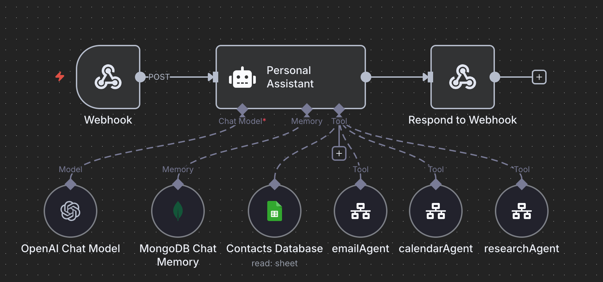
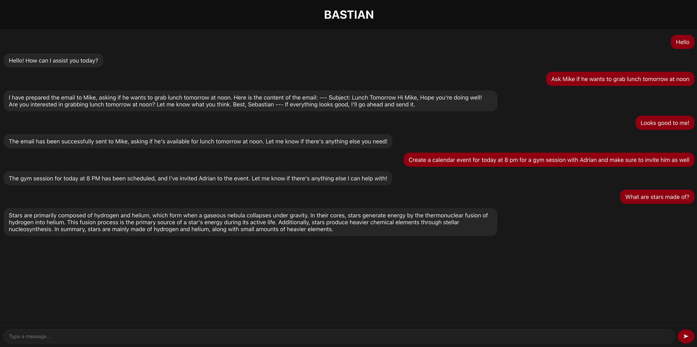

# AI Personal Assistant

An AI-powered personal assistant built with **React**, **Flask**, **MongoDB**, **n8n**, and **OpenAI**.  
This project enables natural language task automation, research, scheduling, and communication with persistent memory.

---

## Features

- **React Frontend**  
  - Chat-style interface with real-time updates  
  - Smooth auto-scrolling and user-friendly design  

- **Flask Backend**  
  - Provides RESTful `/api/message` endpoint  
  - Routes messages between frontend, n8n workflows, and AI model  

- **n8n Integration**  
  - Orchestrates workflows for research, scheduling, and emails  
  - Handles AI calls via OpenAI API inside n8n  
  - Connects to third-party services (calendar, email, contacts)  

- **OpenAI Model**  
  - Intelligent response generation  
  - Natural language understanding for commands and tasks  

- **MongoDB Chat Memory**  
  - Stores and retrieves user-specific conversation history  
  - Provides context-aware responses  

---

## Architecture



1. User sends a message from the React frontend.  
2. Flask backend forwards the request to n8n via a webhook.  
3. n8n processes the request using OpenAI, tools, and memory.  
4. Results are returned to Flask and displayed in the frontend chat.  

---

## Setup

### Prerequisites
- Node.js & npm  
- Python 3.x & pip  
- MongoDB instance  
- n8n running (cloud or self-hosted)  
- OpenAI API key  

### Installation

**Frontend (React):**
```bash
cd frontend
npm install
npm start
```

**Backend (Flask):**
```bash
cd backend
pip install -r requirements.txt
python app.py
```

### n8n Workflows

Workflow templates live in [`n8n/`](n8n/). All credentials and personal IDs have been removed — replace the `YOUR_*` placeholders after importing.

| File | Purpose |
|------|---------|
| `AI-Assistant.json` | Main agent. Webhook → GPT-4o agent with MongoDB memory, Contacts sheet, and the three sub-agents as tools |
| `Email-Agent.json` | Sends and reads Gmail messages |
| `Calendar-Agent.json` | Creates events (with or without attendees) and lists events in Google Calendar |
| `Research-Agent.json` | Answers questions using Wikipedia, falling back to Hacker News |

**1. Import the sub-agents first**  
In n8n, import `Email-Agent.json`, `Calendar-Agent.json`, and `Research-Agent.json`. Save each one and copy its workflow ID from the URL (`/workflow/<ID>`).

**2. Import the main assistant**  
Import `AI-Assistant.json`, then open the `emailAgent`, `calendarAgent`, and `researchAgent` tool nodes and paste the IDs from step 1 in place of:
- `YOUR_EMAIL_AGENT_WORKFLOW_ID`
- `YOUR_CALENDAR_AGENT_WORKFLOW_ID`
- `YOUR_RESEARCH_AGENT_WORKFLOW_ID`

**3. Add credentials**  
Each node will prompt for credentials on first open:

| Credential | Used by |
|------------|---------|
| OpenAI API | All four workflows |
| Gmail OAuth2 | Email Agent |
| Google Calendar OAuth2 | Calendar Agent |
| Google Service Account | Contacts Database (AI Assistant) |
| MongoDB | MongoDB Chat Memory (AI Assistant) |

**4. Replace remaining placeholders**

| Placeholder | Where | Replace with |
|-------------|-------|--------------|
| `YOUR_NAME` | Email Agent prompt + `Send Email` sender name; AI Assistant prompt examples | The name to sign emails with |
| `YOUR_GOOGLE_SHEET_ID` | `Contacts Database` node | ID of a Google Sheet with contact names and email addresses (share it with your service account) |
| `YOUR_DATABASE_NAME` | `MongoDB Chat Memory` node | Your MongoDB database name |
| `YOUR_SESSION_KEY` | `MongoDB Chat Memory` node | Any unique string (one chat history per key) |

The Calendar Agent uses your `primary` calendar by default — change it in the three calendar nodes if needed.

**5. Activate**  
Activate the AI Assistant workflow. The production webhook URL will be:
```
https://<your-n8n-host>/webhook/personal-assistant
```
The webhook expects a POST with a JSON body like `{"text": "your message"}`.

### Configuration
- Set `N8N_URL` in `app.py` to the production webhook URL from step 5.  

---

## Usage

- Start the React app → open `http://localhost:3000`  
- Start the Flask backend → runs on `http://localhost:5000`  
- Chat with the assistant in real time  

- Try natural language commands like:  
  - “Schedule a meeting with John tomorrow at 3 PM”  
  - “Send an email to Sarah about the project update”  
  - “Research the latest AI frameworks”  

---

## Tech Stack
- **Frontend:** React, CSS  
- **Backend:** Flask, Python  
- **AI & Orchestration:** OpenAI, n8n  
- **Database:** MongoDB  
- **Integrations:** Google Sheets (contacts), Google Calendar, Gmail, Wikipedia, Hacker News